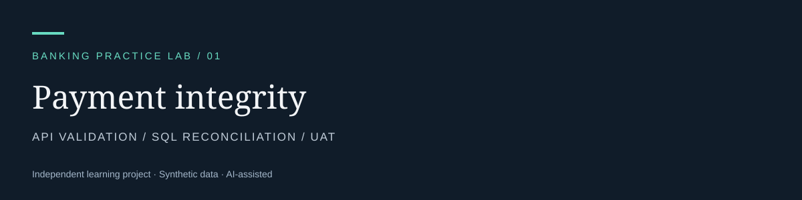

# Banking payment validation lab

**Can a customer retry a payment without being charged twice?**

This small working banking simulation turns that business question into acceptance criteria,
HTTP tests and SQL reconciliation. It is inspired by general account/payment workflows relevant
to the owner's recalled FIS Digital One exposure; it is **not an FIS project or a reconstruction
of employer work**. The implementation is an internal account transfer, not ACH processing.

| Business concern | Evidence to inspect |
|---|---|
| Duplicate request debits twice | [Idempotency contract](docs/api-contract.md) and [HTTP tests](tests/test_api.py) |
| UI success does not match stored data | [SQL reconciliation](sql/validation.sql) |
| Invalid payment changes a balance | Negative cases and atomic transaction checks |
| Team cannot agree on “done” | [Requirements and UAT](docs/requirements-uat.md) |

## Start with the case study

[Read the case study](docs/case-study.md) · [See executed evidence](evidence/results.md) · [Practise the walkthrough](WALKTHROUGH.md)

## Run locally

Requires Python 3.10+; no additional packages. Open a terminal **inside this project folder**.

```shell
python -m unittest discover -s tests -v
python app.py
```

The API runs at `http://127.0.0.1:8765`. The server uses a fresh **in-memory** synthetic database
each time it starts. Stop it with Ctrl+C. Nothing is sent to a bank. Import
`postman/payment-validation.postman_collection.json` into Postman and run its requests in order.
Use the desktop app/local agent for localhost access. A collection run makes one new $12.50
transfer; restart the demo server to restore starting balances.

`python make_evidence.py` starts an isolated local server, runs the collection's request cases
and SQL controls, and writes reproducible results. Postman scripts are separately checked by
the supplied JavaScript harness; this is not a claim of a Postman UI run.

## What this demonstrates

Business-rule clarification, API request/response validation, negative testing, SQL joins and
aggregations, duplicate prevention, traceability and evidence-based defect analysis.
Code provides a test system for the BA work; this is not presented as a production banking API.

## Boundaries

No real customer data, authentication, external settlement, ACH files, KYC/AML checks, fees,
FX, scheduled payments or production security. USD integer cents are used to avoid floating
point money errors. A single-process lock serializes writes for this demonstration.
All funds are synthetic. [Read the provenance](PROVENANCE.md).
